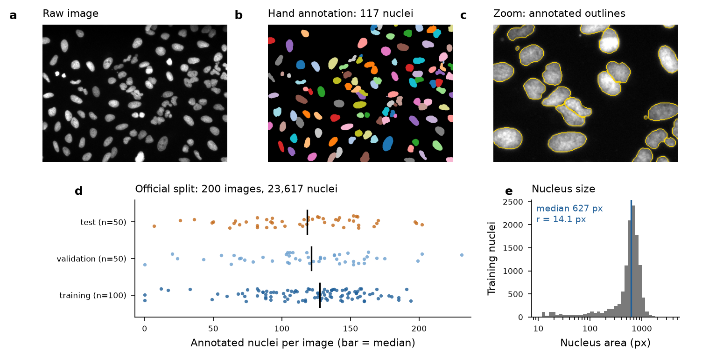

# Automated Nucleus Counting with Classical Image Processing

BME 240 final project (University of Illinois Chicago, Fall 2026). A MATLAB pipeline, with a matching Python implementation, that counts fluorescently stained cell nuclei and is checked against expert hand annotations.

> **Status (work in progress).** The full counting pipeline is implemented and validated in Python on the real BBBC039 dataset (tuned on the official training and validation images, scored once on the 50 held-out test images). The MATLAB version implements the same steps and parameters but **has not yet been run in MATLAB**, so its numbers may differ slightly from those below. Still to do: the BBBC005 robustness experiments (added noise, illumination gradient, blur) and the manual-count comparison.

## Results on the 50 held-out BBBC039 test images

The tuned pipeline detected 5,213 of the 5,720 annotated nuclei (precision 0.987, recall 0.899, mean per-image F1 0.934). Its mean count error is 10.2 nuclei per image (9.6%), and it consistently **undercounts** (bias -10.1 nuclei/image).

| Method | Precision | Recall | Mean F1 | Count MAE (nuclei) | Mean % error | Bias | R² | p (F1) | p (count error) |
|---|---|---|---|---|---|---|---|---|---|
| Tuned pipeline | 0.987 | 0.899 | 0.934 | 10.2 | 9.6% | -10.1 | 0.969 | — | — |
| Baseline (Otsu + count only) | 0.788 | 0.836 | 0.817 | 12.5 | 12.2% | +7.1 | 0.869 | < 0.001 | 0.81 |
| Without background removal | 0.986 | 0.899 | 0.933 | 10.2 | 9.6% | -10.1 | 0.969 | 0.35 | 0.65 |
| Without clean-up | 0.959 | 0.917 | 0.930 | 5.9 | 6.2% | -5.0 | 0.970 | 0.03 | < 0.001 |
| Without watershed | 0.985 | 0.785 | 0.873 | 23.2 | 19.9% | -23.2 | 0.942 | < 0.001 | < 0.001 |

*p values: paired Wilcoxon signed-rank test against the tuned pipeline across the 50 test images. Detection matching: a detection is correct if its centroid falls inside an annotated nucleus that has not already been matched (one-to-one). Mean % error excludes images with fewer than 5 nuclei.*


**What the numbers show**
- **Watershed splitting is the most important step.** Removing it drops F1 by 0.06 and more than doubles the count error, because touching nuclei are then counted as one.
- **The baseline (Otsu threshold + count, nothing else) gets a similar average count error, but for the wrong reasons.** Its precision is only 0.79: it overcounts noise specks and undercounts merged nuclei, and the two errors partly cancel. Its F1 is 0.12 lower (p < 0.001), and its count limits of agreement are more than twice as wide (−25.9 to +40.0 vs. −25.6 to +5.3 nuclei). This is why the project reports detection F1 and not only the count.
- **Background removal (top-hat) had no measurable effect** on BBBC039, which has an even background. It is kept because it is expected to matter on unevenly lit images (to be tested on BBBC005).
- **No noise filter was selected.** On these low-noise images, every Gaussian and median setting slightly lowered F1 (best F1: no filter 0.922, median 3×3 0.920, Gaussian σ = 1 0.919). The filter comparison will be repeated with added noise.
- **Clean-up trades count accuracy for precision.** Removing it lowers F1 slightly (−0.003, p = 0.03) but reduces the count error, because the minimum-size filter also removes some genuinely small nuclei.

## The pipeline


All size parameters are multiples of the typical nucleus radius *r* = 14.1 px, measured from the training annotations as r = √(median area / π).

| Step | What it does | MATLAB | Python | Locked setting |
|---|---|---|---|---|
| 1 Normalize | scale to [0, 1] | `mat2gray` | `normalize` | — |
| 2 Background | white top-hat | `imtophat`, `strel('disk')` | `morphology.white_tophat` | disk radius 3r |
| 3 Denoise | Gaussian or median | `imgaussfilt` / `medfilt2` | `filters.gaussian` / `ndimage.median_filter` | none |
| 4 Threshold | Otsu or local mean + offset | `graythresh` / `imboxfilt` | `threshold_otsu` / `uniform_filter` | adaptive, window 113 px, offset 0.02 |
| 5 Clean-up | fill holes, open, remove small | `imfill`, `imopen`, `bwareaopen` | `binary_fill_holes`, `binary_opening`, size filter | min area 0.1·πr² ≈ 63 px |
| 6 Split | smoothed distance-transform watershed | `bwdist`, `imgaussfilt`, `imextendedmin`, `watershed` | `distance_transform_edt`, `gaussian`, `h_maxima`, `watershed` | h = 0.5 px, smoothing σ = 2 px |
| 7 Count | 4-connected labeling + centroids | `bwconncomp`, `regionprops` | `measure.label`, `regionprops` | — |

**A fix found during development.** A watershed applied to the *raw* distance transform over-split many single nuclei: its pixel-scale ridges create extra peaks that the h-minima step does not remove. This pushed precision down to about 0.85 regardless of h. Smoothing the distance map with a 2-px Gaussian before finding markers solved this, raising tuning-set F1 from 0.870 (best without watershed) to 0.922.

**Parameter search.** 360 combinations were scored on the 150 training and validation images: top-hat on/off × 5 filters × 3 thresholds × 2 minimum sizes × 6 watershed settings. See `results/tuning_grid.csv`. The test images were used only once, after the parameters were locked (`results/best_params.json`).

## Data



**BBBC039** (Broad Bioimage Benchmark Collection, CC0): 200 fluorescence images (520 × 696 px, 16-bit) of Hoechst-stained U2OS nuclei. Each image comes from a different compound in a chemical screen. There are 23,617 hand-annotated nuclei, with an official split of 100 training, 50 validation and 50 test images. The annotation PNGs store a map colouring in the red channel (values 1–3, touching nuclei always differ), so each nucleus is a 4-connected component of one value (`loadBBBC039Mask.m`, `cellcount.load_bbbc039_mask`).

The data are not stored in this repository. Download them with:

```bash
bash scripts/download_data.sh      # ~80 MB into data/BBBC039
```

## How to run

**MATLAB** (Image Processing Toolbox; Statistics and Machine Learning Toolbox for `signrank`):

```matlab
cd matlab
runDemo            % one image: step-by-step figure + precision/recall/F1
runBBBC039Test     % 50 test images: tuned vs. baseline vs. ablations
```

**Python** (reference implementation that produced the results above):

```bash
pip install -r requirements.txt
python python/tune_bbbc039.py  --data data/BBBC039 --out results   # parameter search (~25 min on 7 cores)
python python/evaluate_test.py --data data/BBBC039 --out results   # one-time test evaluation
python python/make_figures.py  --data data/BBBC039 --results results --out figures
```

## Repository layout

```
matlab/    countCells.m, defaultParams.m, loadBBBC039Mask.m, matchDetections.m,
           readSplit.m, runDemo.m, runBBBC039Test.m, manualCount.m
python/    cellcount.py (pipeline + scoring), tune_bbbc039.py, evaluate_test.py, make_figures.py
results/   dataset summary, tuning grid, locked parameters, per-image and summary test results
figures/   figures shown in this README
scripts/   download_data.sh
```

## Known limitations

- **Systematic undercount (≈10 nuclei/image).** Most missed nuclei are small or dim. About 10% of annotated objects are smaller than 25% of a typical nucleus.
- **One test image fails badly** (`IXMtest_A12_s7`: 19 detected vs. 69 annotated, F1 0.41). Its nuclei are fragmented and small (median annotated area 131 px vs. 627 px overall), probably as an effect of the compound.
- **Centroid matching is lenient.** It checks that each nucleus was found, not how accurately its outline was traced.
- **The MATLAB code has not been executed yet.** Otsu, top-hat and watershed are implemented slightly differently in MATLAB and scikit-image, so small numerical differences are expected.

## References

- Ljosa V, Sokolnicki KL, Carpenter AE. Annotated high-throughput microscopy image sets for validation. *Nature Methods* 9, 637 (2012).
- Caicedo JC, Roth J, Goodman A, et al. Evaluation of deep learning strategies for nucleus segmentation in fluorescence images. *Cytometry Part A* 95, 952–965 (2019). (BBBC039)
- Otsu N. A threshold selection method from gray-level histograms. *IEEE Trans. Syst. Man Cybern.* 9, 62–66 (1979).
