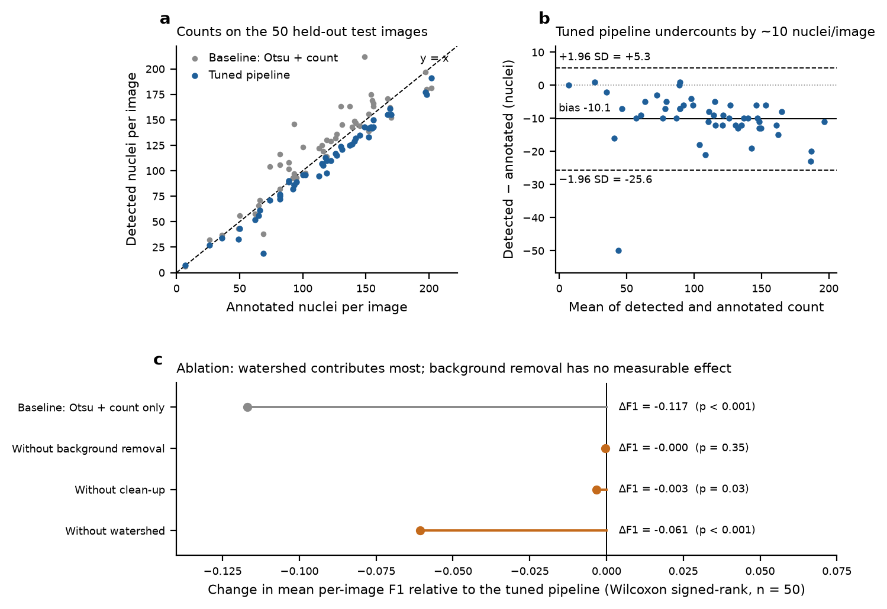
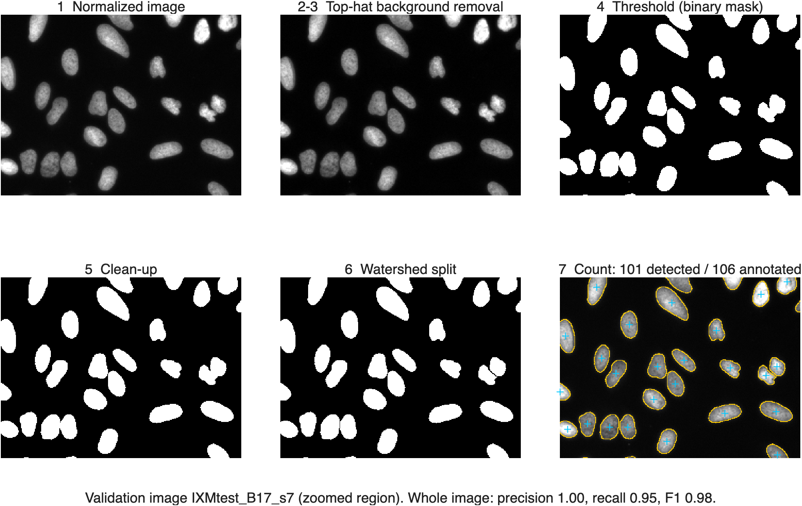

# BME 240: Automated Nucleus Counting

Counts fluorescently stained nuclei using classical image processing, and checks the counts against the hand annotations in the BBBC039 dataset. The MATLAB code in `matlab/` is the course deliverable. The Python code in `reference/` is an independent cross-check of the same steps; it produced the results below.

**Status:** The MATLAB pipeline, tuning, test, figure and parity scripts are complete. On synthetic images the MATLAB code (run in GNU Octave) gives the same counts as Python. It has not yet been run in MATLAB on BBBC039, so the numbers and figures below are still from Python. Not started: the robustness tests on BBBC005 and the manual counts.

## Pipeline

1. Normalize the image to [0, 1].
2. Remove the background with a top-hat filter (disk radius 3r).
3. Noise filter (Gaussian or median). None was selected.
4. Adaptive threshold: a pixel is a nucleus if it is brighter than the local mean (113 px window) plus 0.02.
5. Fill holes, apply an opening (1 px disk), and remove objects smaller than 63 px.
6. Watershed on the distance map, smoothed with σ = 2 px, with h-minima depth 0.5 px.
7. Label the separate objects (`bwconncomp`). The count is the number of objects.

r = 14.1 px is the median nucleus radius in the training annotations. The settings above were chosen from 360 combinations tested on the 150 training and validation images (`results/tuning_grid.csv`; MATLAB: `runTuning.m`).

## Results (50 test images, scored once, Python reference)

| Method | Precision | Recall | F1 | Count error |
|---|---|---|---|---|
| Full pipeline | 0.987 | 0.899 | 0.934 | 10.2 (9.6%) |
| Baseline: Otsu + count | 0.788 | 0.836 | 0.817 | 12.5 (12.2%) |
| Without watershed | 0.985 | 0.785 | 0.873 | 23.2 (19.9%) |
| Without top-hat | 0.986 | 0.899 | 0.933 | 10.2 (9.6%) |
| Without clean-up | 0.959 | 0.917 | 0.930 | 5.9 (6.2%) |

F1 is the mean per image. A detection counts as correct if its centroid falls inside an annotated nucleus that hasn't already been matched. Count error is the mean absolute error per image. Full per-image results, and p values from paired Wilcoxon signed-rank tests, are in `results/`.

- Watershed matters most. Without it, touching nuclei are counted as one.
- The baseline's count error looks reasonable only because its false detections and its merged nuclei cancel out. Its F1 is much lower (p < 0.001).
- The top-hat and noise filters did not help on BBBC039, which has even lighting and little noise.
- The pipeline undercounts by about 10 nuclei per image, mostly by missing small or dim nuclei.





## Running it

Download the data (BBBC039, about 80 MB, CC0):

```bash
bash scripts/download_data.sh
```

MATLAB R2020b or newer with the Image Processing Toolbox. The Statistics Toolbox (`signrank`) and Parallel Computing Toolbox (`parfor`) are optional; without them `signrankTest.m` and a plain loop are used. Outputs go to `results/matlab/` and `figures/`.

```matlab
cd matlab
runtests('tests')    % unit tests (the BBBC039 tests need the data)
runDemo              % one image, step-by-step figure
runTuning            % 360-configuration grid on training + validation
runBBBC039Test       % test set, once: tuned pipeline vs. baseline vs. ablations
makeFigures          % fig1-fig3
compareStrelDisk     % top-hat disk: strel default (N = 4) vs. exact (N = 0)
parityCheck          % MATLAB vs. Python, writes results/matlab/parity.md
```

Python reference:

```bash
pip install -r reference/python/requirements.txt
python reference/python/tune_bbbc039.py  --data data/BBBC039 --out results
python reference/python/evaluate_test.py --data data/BBBC039 --out results
python reference/python/make_figures.py  --data data/BBBC039 --results results --out figures
python reference/python/dump_steps.py    --data data/BBBC039 --results results   # masks for parityCheck
```

## Notes

- Watershed on the raw distance map split many single nuclei in two. Smoothing the map first fixed this.
- The masks store touching nuclei as different values (1–3) in the red channel. Each nucleus is one 4-connected region of a single value (`loadBBBC039Mask.m`).
- One test image (`IXMtest_A12_s7`) fails: it has 69 annotated nuclei but only 19 are detected, because its nuclei are small and broken into fragments.
- Changes to make the MATLAB watershed (`splitTouching.m`) match the Python reference. The algorithm is unchanged.
  - Markers are the tops of peaks at least h high, as in skimage `h_maxima`, built with `imreconstruct`. `imextendedmin` returns the whole plateau within h of each peak. Without clean-up, one plateau covers several noise specks, and every speck it touches survives.
  - Flooding stays inside the foreground, and components with no marker are dropped, as in skimage `watershed(..., mask=bw)`. The old code flooded the whole image and kept them. On synthetic images without clean-up it counted 984–1,630 objects where Python counted 84–93. With these changes it counts 84–94, and 0–1 apart on each image.
  - `watershed` keeps its default 8-connectivity. `watershed(D, 4)` treats a marker whose pixels touch only diagonally as two minima, which over-splits.
- The opening uses `strel('disk', 1, 0)` (the exact 3×3 cross, as in Python). The top-hat disk keeps strel's default approximation (N = 4); `compareStrelDisk.m` measures what that changes.
- On 3 synthetic 520×696 images, the MATLAB code (in Octave) and Python gave identical counts. The threshold and clean-up masks were pixel-identical once both used an exact top-hat disk; all remaining differences came from skimage's approximate disk. The watershed masks agree on 99.86% of pixels, because MATLAB and skimage place the cut lines slightly differently.
- Python rounds centroids half-to-even and MATLAB rounds half away from zero, so a few centroids that lie exactly on a pixel edge are scored against a neighbouring pixel.

## Data

Ljosa et al., *Nature Methods* 9, 637 (2012). Caicedo et al., *Cytometry A* 95, 952 (2019). https://bbbc.broadinstitute.org/BBBC039
